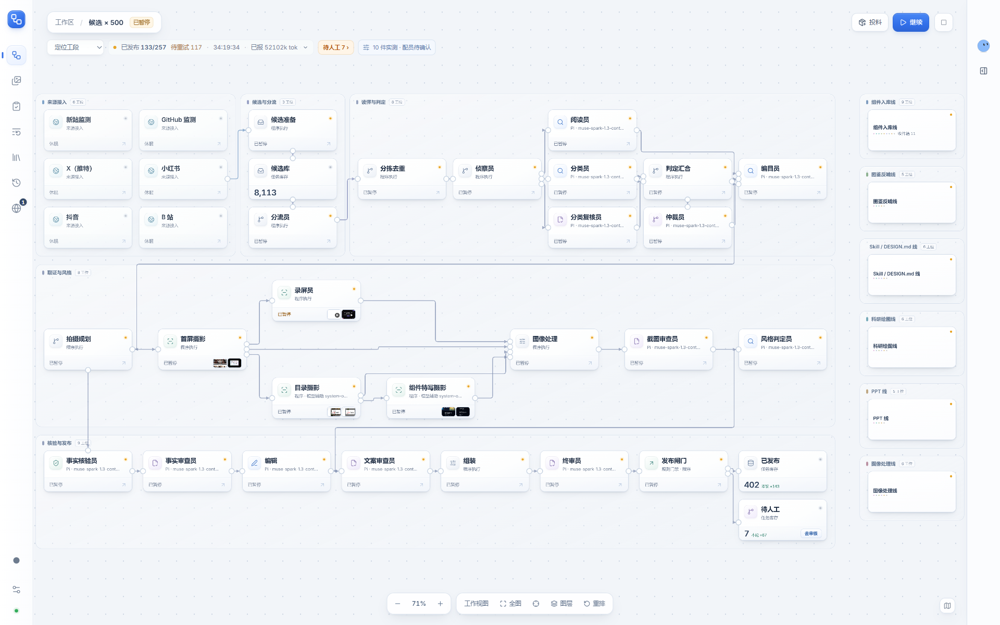
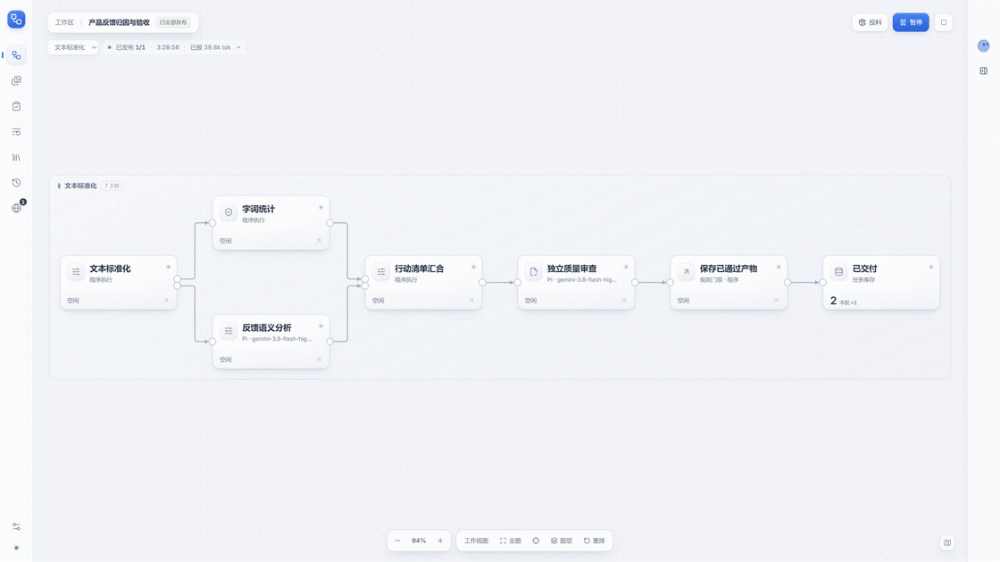
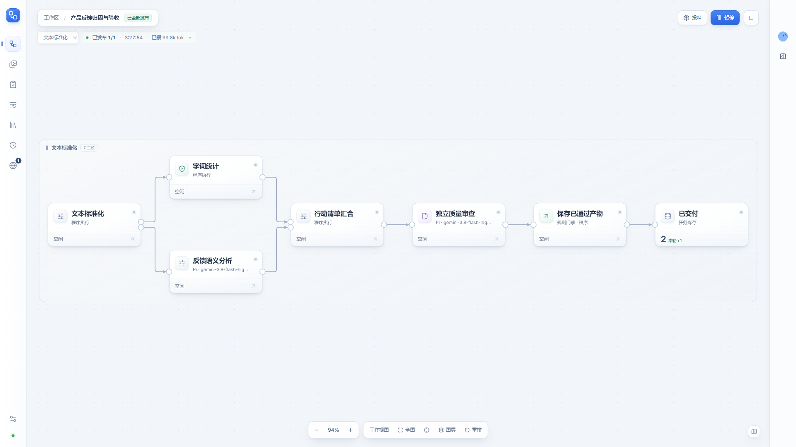
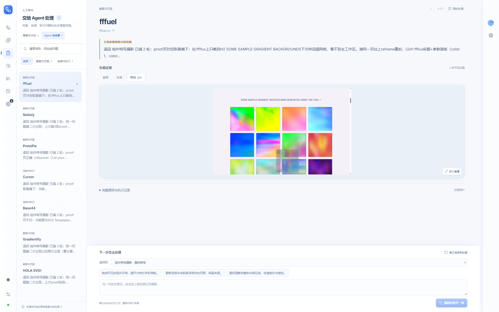

# Easy Workflow

Easy Workflow 是本地运行的多 Agent 工作流应用。把目标交给主调度，由它创建线路、连接节点、试跑并核对真实产物；你可以在画布上查看进度、打开证据，从失败的位置继续。

[下载 Windows 桌面版](https://github.com/Wang-auspicious/easy-workflow/releases/latest) · [v0.3.0 更新说明](docs/whats-new-2026-10-17.md) · [自主建线实测](docs/workflow-authoring-live.md)



## 30 秒真实演示

[](https://github.com/Wang-auspicious/easy-workflow/releases/download/v0.3.0/EasyWorkflow-v0.3.0-demo.mp4)

[查看 / 下载 1080p MP4](https://github.com/Wang-auspicious/easy-workflow/releases/download/v0.3.0/EasyWorkflow-v0.3.0-demo.mp4)。这是 v0.3.0 桌面程序的 30 秒连续界面实录，展示已经完成的真实模型运行记录：定位自建线路 → 打开工位消息 → 查看交付链 → 浏览流水线库。完整建线、试跑和运行过程见[实测记录](docs/workflow-authoring-live.md)。

## 主调度自己建线

告诉它目标和输入，它可以保存完整的节点、连线、角色与输入输出契约，按错误诊断修改草稿，用真实执行器隔离试跑，再启用同一版本并处理正式任务。串行、并行汇合、条件分支、独立审查、有界返工和跨线交接均可声明；交付时核对实际文件、字节数和 SHA-256。



上图的反馈分析线由真实主调度创建：程序标准化后，并行运行统计程序与分析 Agent，再经过汇合、独立审查和发布。6 条反馈得到 4 类问题，每个编号恰好覆盖一次；重启后找回的 JSON 仍通过摘要核验。详见[建线能力与边界](docs/workflow-authoring.md)。

## 让人只看需要判断的事

技术故障先由 Agent 诊断和有限恢复。缺少页面来源时复用原证据重建记录；截图取景、普通弹窗和预算交接有对应恢复能力。真正需要登录、验证或内容取舍的任务单独留下，原有审查与发布闸门继续执行。



审计页默认只看“需要你决定”，可以切到“Agent 待修复”；每次聚焦一件事，原始原因与执行记录按需展开。本次 41 条历史待审任务实测中，27 条对应成果通过发布检查（25 条本次恢复、2 条既有成功结果），14 条仍保留为技术待修，需用户判断为 0。没有把未通过的条目算作成功。

## 日常使用

- **画布与工位详情**：节点统一尺寸，程序和 Agent 如实区分；点击工位消息查看任务及其证据链。
- **正常的 Agent 对话**：`/new`、`/clear` 真正开启新上下文，`/history` 搜索旧对话；历史与流水线任务保留。支持命令补全、复制、再次编辑、长消息展开和中断续接。
- **七条预置业务线**：策展、组件、图鉴反哺、Skill / DESIGN.md、科研绘图、PPT、图像处理均已接入执行器；也可从模板或空白图搭建流程。
- **本地项目与可恢复执行**：规格、日志、证据、草稿、试跑回执和产物保存在项目目录中。界面与 Agent 使用同一套能力接口。

默认仍使用 v1 内核；v2 长运行及部分业务质量验收仍有缺口。接入执行器和有限样本通过不代表全部业务质量已经验收，详见[本版已知问题](docs/whats-new-2026-10-17.md#尚未完成和已知问题)与[产品规格](Spec.md)。


## 启动

- **已打包：**从 [Releases](https://github.com/Wang-auspicious/easy-workflow/releases/latest) 下载 Windows x64 ZIP，完整解压后双击 `EasyWorkflow.exe`，保留同目录的全部文件。显示界面和使用内置浏览器无需另装 Node 或 Chrome。
- **源码：**安装 Node 24+，运行 `npm install`，再运行 `npm run dev`。该命令构建界面并打开 Electron；关闭窗口时会关闭本次启动的后台。
- **构建：**`npm run build`，产物位于 `dist/desktop`。
- **打包：**`npm run package -- --zip`，生成应用目录和 ZIP，并核对文件清单、大小及可执行文件摘要。
- **并存测试版本：**`npm run package -- --name=EasyWorkflow-review`，输出到独立的 `release/EasyWorkflow-review/`，适合保留当前运行版本时验证新构建。

构建和打包当前预置策展包前，需要将 `VISLEXICON_ROOT` 设为包含规则资料的本机目录（其中有 `Spec.md` 与 `VisLexicon-browser-design-kit/`）。未配置或资料不完整时构建会直接报错，并保留已有产物；运行已打包应用不需要该源码目录。

应用菜单默认隐藏，按 **Alt** 可打开。“项目”菜单支持新建、打开、最近项目和在文件管理器中显示。默认项目目录为用户文档目录下的 `Easy Workflow/Projects/<项目名>`。模型配置、界面配置与项目数据分别保存；旧项目迁移只复制，不移动或删除来源。

## 项目与数据

流水线库支持从模板创建、安装已有包，也可点“从空白开始”添加程序节点、拖动位置并通过端口连接。选择节点后编辑输入输出契约、输入映射和验收条件；草稿在明确安装前不生效，关闭编辑面板或刷新页面后可恢复。当前空白图支持文本标准化、字词统计、高频词、汇总和 JSON 文件交付；复杂 Agent、外部工具及条件/退回流程继续通过模板或包声明接入。

每个项目包含 `PROJECT.md`、`journal.db`、`evidence/`、`published/`、`cases/`、`context/`、`work/` 和 `LESSONS.md`。日志记录状态变化；每件任务的 `CASE.md` 与 `case.json` 保留跨轮次的证据、动作和审查往来，重启时可从日志重建。经验草案绑定具体的验证任务，经过失败样本重跑和已发布条目回归后，仍需用户批准才能追加到角色手册。

预置策展包读取 VisLexicon 的分类规则、风格规则和条目校验器。可通过应用菜单连接本机资料目录；没有连接资料时可以查看工作台，候选库为空。已发布产物写进当前项目，写入外部正式目录需要用户确认。

桌面采集复用内置浏览器的持久标签页和登录会话。登录墙、验证页或授权失败会保留现场并提示处理，程序不会填写凭据或绕过验证。独立服务使用本机 Chrome/Edge 的持久 profile；录屏和图像处理需要 `ffmpeg`。应用恢复未结束的轮次时先暂停，由用户选择继续。

## Agent 接入

`npm run server` 可独立运行，默认监听 `http://127.0.0.1:4317`。`FACTORY_VAR` 指定项目目录，`FACTORY_PORT` 指定端口；设置 `FACTORY_TOKEN` 后，请求使用 `Authorization: Bearer <token>`。凭据不得写进提示词、日志或仓库。

先读取 `GET /api/agent/bootstrap` 获取当前能力索引，再按需读取 `/api/agent/tools/<name>` 的参数契约，向 `/api/tools/<name>` 提交 JSON：

```text
POST /api/tools/status          {}
POST /api/tools/feed_urls       {"urls":["https://example.org"]}
POST /api/tools/inspect         {"token":"投料回执中的任务 ID"}
POST /api/tools/read_report     {"runId":"运行回执中的轮次 ID"}
```

成功回执包含 `ok, tool, result, summary, seq, runId`；错误包含 HTTP 状态与 `code, error`。快照、增量事件和日志分别位于 `/api/state`、`/api/events`、`/api/journal`。写请求中断后先检查回执、任务与日志，再决定是否重试。

控制面提供 stdio MCP：客户端启动 `node server/mcp.ts`，通过 `easy_workflow_help` 查询能力，通过 `easy_workflow_call` 调用。工位 Agent 只得到本工位的 `env_help`、`env_call` 和 `submit`，不能取得全局调度或批准权限。闭源 launcher 接口和完整协议见 [Agent 接入契约](docs/mcp-agent-contracts.md)；协议测试通过不代表所有厂商客户端都已完成真实模型验证。

Pi 客户端可运行一次 `npm run pi:install` 安装自动发现扩展；已有会话执行 `/reload`。之后每次请求自动读取当前服务的简短能力说明，无需手工复制端口和 token。其他客户端也可直接使用 HTTP 接口。

## 模型与依赖

默认模型执行使用 Pi 的 `pi-agent-core` 与 `pi-ai`。配置读取本机 Pi 的 `settings.json`、`models.json` 和 `auth.json`；`PI_CODING_AGENT_DIR` 可选择配置目录，`FACTORY_PROVIDER` / `FACTORY_MODEL` 可覆盖模型选择。配置了 `FACTORY_STATION_COMMAND` 的工位使用外部 launcher，其参数和返回契约见接入文档。

模型请求遵循代理设置，本地请求直连。开跑体检会执行一次输出上限为 1024 tokens 的真实模型请求，验证凭据和推理接口，会产生少量用量。Pi 工位遇到瞬断时，保留已完成的工具结果，在原时限内继续一次；不会从头重做整个工位。

新记录的耗时色条使用模型等待、输出和工具调用的真实起止时间，并显示并行活动。旧记录的分项比例仍标注估算；Token 色条始终为比例估算。缺少用量、缓存或结束时间时保留未知状态，累计并行工作时间与整轮时间分别统计。

消息界面使用 Pi Web UI 的部分组件；来源、改动说明和 MIT 许可保存在 `ui/src/vendor/pi-web-ui/`，发布构建携带许可。Electron、Playwright 和其他依赖的准确版本见 `package-lock.json`。产品构建不包含私有证据、模型密钥、候选库、原始验收报告或 `legacy/`。

## 验证

```powershell
npm test
npm run typecheck
npx tsc -p ui/tsconfig.json
npm run build
npm run desktop:smoke
```

普通测试使用隔离项目与协议样本，不调用外部模型。`npm test` 默认按文件串行运行，避免多个浏览器套件抢占资源；`npm run typecheck` 同时检查后台与 UI。桌面检查覆盖 Electron、共享浏览器、项目隔离、持久化和退出清理；真实站点产出另行验收，不用 fixture 代替。`scripts/check-pi-live.mjs` 使用实际模型进行只读验证，会消耗模型用量。规格逐项核对见[本轮审查记录](docs/spec-audit-2026-10-12.md)。

打包后可运行同样的桌面检查：

```powershell
node scripts/desktop-smoke.mjs --packaged --exe=release/EasyWorkflow-win32-x64/EasyWorkflow.exe
```

`FACTORY_PROFILE` 指向独立测试 profile，`FACTORY_VIEW_VAR` 以只读方式打开已有项目；`FACTORY_DESKTOP_TEST=1` 开启仅主进程可见的测试诊断。开发约定见 [AGENTS.md](AGENTS.md)。
