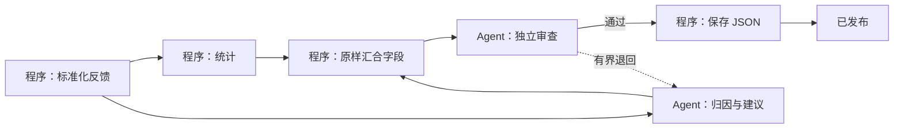

# 主 Agent 自主建线实测

## 验收范围

本次使用已有的 Pi / `cliproxy / gemini-3.8-flash-high` 配置，让真实主调度从自然语言目标创建新线、连接节点、撰写角色与契约、试跑、启用并处理正式输入。测试运行在独立临时项目；没有使用模拟模型回答，也没有改动用户的生产项目。

主调度创建了 `feedback-intelligence`（产品反馈归因与验收），共 7 个节点：



## 发现与修复

- 首轮试跑把对象断言误写成局部匹配，并猜测固定产物路径。主调度随后删去字段断言，只检查已发布。这不构成充分验收。补充精确字段断言规则、预期与实际值、失败节点诊断后，要求主调度重新证明输出条件。
- 增加 `workflow_edit`，允许主调度只改错误节点、连接、输入映射与角色。所有操作在副本上原子应用，拒绝过期版本与非法路径。真实主调度遇到错误路径和参数后，根据工具诊断完成修复。
- 首版用额外 Agent 汇合已存在的数据。新增 `compose-json` 后，主调度自行把该节点改为程序，保留两个真实模型岗位：分析与独立审查。审查退回改为指向分析岗位。
- 增加 `workflow_result`。通用执行器的接受结果实际保存在任务的 `outputKey` 字段，而非可选的 attempt.output。核验据此查找真实文件，验证任务归属、字节数与 SHA-256，避免把历史已发布状态当成当前文件仍然正确。

## 实际结果

最终启用前的真实试跑检查 `synthesized.feedbackCount = 3` 和 `synthesized.statistics.paragraphs = 3`，全部通过，未覆盖工位为空。正式输入的 6 条反馈归并成 4 类问题；6 个编号各覆盖一次，重复白屏反馈归入同一问题，建议非空，独立审查通过。统计结果为 180 字符、6 段。

最终 JSON 为 2,146 字节，SHA-256：

```text
991b37d9a4bb8a56ab85b30339fa3b29e3d0373fded756fcc9d088ec9cc5e50d
```

重启同一隔离项目后，主调度用 `workflow_result` 找回并验证该产物，返回 `readyForDelivery: true`，未再次投料。两次正式运行分别保存首版与改进版产物；旧版本和记录均保留。有限样本证明本次执行路径成功，不代表所有可能的语义错误和返工分支都已经真实模型验收。

## 回归与桌面验证

- 类型检查通过，UI 单元测试 45/45 通过。
- 自主建线集成测试 3/3 通过，覆盖 v1/v2、原子修改、过期版本、失败修复、输出断言和产物篡改拒绝。
- 工作流包、控制接口、MCP 与调度恢复测试合计 54/54 通过。
- 新桌面包原生回归 25/25 通过，包括隔离项目、真实浏览器、重启持久化、只读保护与无渲染异常。
- 桌面包另行打开本次实测项目，确认 7 个自建节点、新能力 schema、真实结果核验及只读日志未变。

## 复现

以下命令会使用本机配置的真实模型并产生模型用量。每次新建独立临时项目，命令输出该目录，原始回执、草稿、试跑和产物留在其中。普通单元测试不会调用它。

```sh
node scripts/workflow-authoring-smoke.ts --scenario=feedback --kernel=v1
node scripts/workflow-authoring-smoke.ts --scenario=feedback --kernel=v1 --resume=<上一步的临时项目目录> --improve
node scripts/workflow-authoring-smoke.ts --scenario=feedback --kernel=v1 --resume=<同一临时项目目录> --improve --verify-existing
```

最后一步不重复提交正式任务，并检查主调度确实读取了核验结果，以及启用所用试跑确实包含输出字段断言。最终证据文件为 `improved-acceptance.json`；原始私有日志不随仓库发布。
